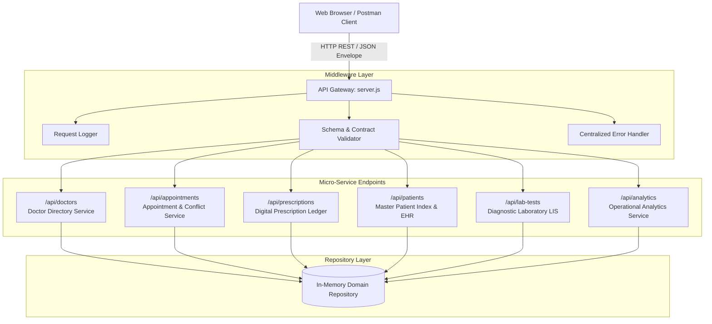
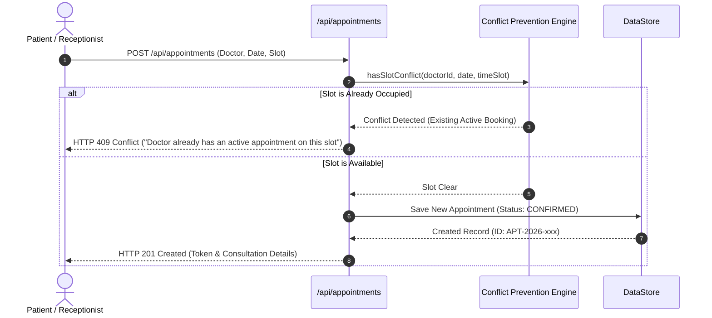
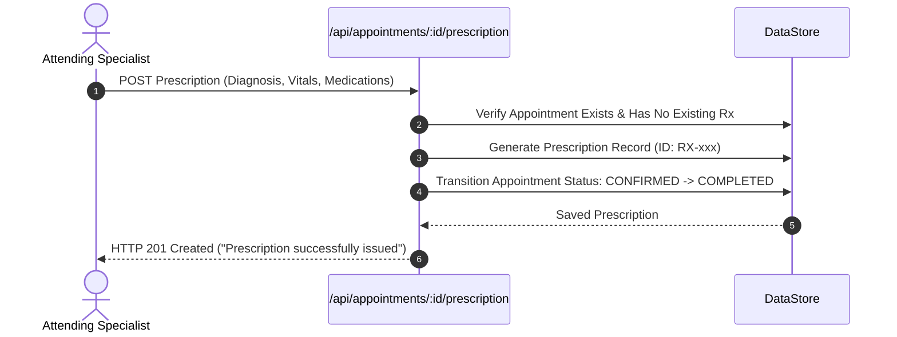

# MediCare RESTful Web Service

> **Service-Oriented Architecture (SOA) Healthcare Operations & Clinical Records Platform**  
> **Course Assessment:** Service-Oriented Architecture (SOA) / Web Services  
> **GitHub Repository:** [https://github.com/goswamimoksh455-max/SOA-Assignment.git](https://github.com/goswamimoksh455-max/SOA-Assignment.git)

---

## Executive Overview

Modern healthcare organizations face acute operational bottlenecks: double-booked specialists, fragmented paper prescriptions prone to drug interaction errors, disconnected patient records across visits, and siloed diagnostic lab reports. 

**MediCare Web Service** resolves these challenges by applying **Service-Oriented Architecture (SOA)** principles. Built on Node.js and Express, it provides six loosely-coupled, highly-cohesive RESTful micro-services accessed through standardized JSON contracts and a minimalist, classic black-and-white Uber-style user interface.

---

## Key Features & Capabilities

* **Specialist Directory Service**: Query active specialists by medical domain (Cardiology, Orthopedics, Pediatrics, Neurology, Dermatology) with verified consultation fees and real-time schedules.
* **Double-Booking Collision Prevention Engine**: Intelligent slot conflict engine enforcing integrity at domain boundaries, returning `HTTP 409 Conflict` upon collision attempts.
* **State-Machine Lifecycle Engine**: Appointments transition through strict states: `CONFIRMED` &rarr; `RESCHEDULED` &rarr; `COMPLETED` (auto-triggered upon prescription issuance) or `CANCELLED`.
* **Clinical Electronic Prescriptions (Rx)**: Structured digital medical prescriptions containing diagnoses, vital signs (BP, Pulse, Weight), multi-item drug regimens, and lifestyle guidance.
* **Master Patient Index (PMI) & Longitudinal Health Records (EHR)**: Unified 360-degree patient timeline aggregating past visits, historical diagnoses, issued medications, and lifetime medical expenditure.
* **Clinical Diagnostic Laboratory Service (LIS)**: Standardized test catalog (CBC, Lipid Panel, HbA1c, ECG, Digital X-Ray) with turnaround times, specimen tracking, and pathology result interpretation (`NORMAL`, `ABNORMAL`, `CRITICAL`).
* **Hospital Operational Analytics**: Real-time aggregated metrics tracking doctor workload distribution, patient volume, completion rates, and department revenue.
* **Classic Black & White Uber Design System**: High-contrast monochromatic UI (`#000000` / `#FFFFFF`), zero emojis, typography-driven pill badges, and accessible in-app modal dialogs.
* **Embedded Postman API Simulator**: Interactive live console executing real HTTP requests across all 15 endpoints with instant latency, status code, and JSON payload inspectability.

---

## SOA Architecture & System Topology

The architecture enforces strict separation between routing, controllers, domain validation, and data persistence.



---

## Core SOA Business Workflows

### 1. Appointment Scheduling with Slot Collision Prevention



### 2. Clinical Consultation, E-Prescription & State Transition



---

## Standardized JSON Service Contract

All endpoints adhere to a uniform, predictable JSON envelope format:

### Success Response Contract
```json
{
  "success": true,
  "statusCode": 200,
  "message": "Resource retrieved successfully",
  "count": 4,
  "data": { ... }
}
```

### Error Response Contract
```json
{
  "success": false,
  "statusCode": 409,
  "error": "Conflict",
  "message": "Schedule Conflict: Dr. Ananya Sharma already has an active appointment on 2026-10-25 at 11:30 AM. Please select another time slot."
}
```

---

## Complete API Reference

| Domain | Method | Endpoint | Description | Status Code |
| :--- | :--- | :--- | :--- | :--- |
| **System** | `GET` | `/api` | Service root metadata & endpoint discovery | `200 OK` |
| **Doctors** | `GET` | `/api/doctors` | List specialists (supports `?specialization=` filter) | `200 OK` |
| **Doctors** | `GET` | `/api/doctors/:id` | Retrieve single specialist profile | `200 OK` / `404 Not Found` |
| **Doctors** | `POST` | `/api/doctors` | Onboard and register a new specialist | `201 Created` / `400 Bad Request` |
| **Appointments** | `GET` | `/api/appointments` | List appointments (supports `?status=`, `?doctorId=`) | `200 OK` |
| **Appointments** | `GET` | `/api/appointments/:id` | Retrieve specific appointment details | `200 OK` / `404 Not Found` |
| **Appointments** | `POST` | `/api/appointments` | Book appointment with automated conflict validation | `201 Created` / `409 Conflict` |
| **Appointments** | `PATCH` | `/api/appointments/:id/status` | Update status (`CONFIRMED`, `COMPLETED`, `CANCELLED`) | `200 OK` / `400 Bad Request` |
| **Appointments** | `PUT` | `/api/appointments/:id/reschedule` | Reschedule date & slot with re-conflict check | `200 OK` / `409 Conflict` |
| **Appointments** | `DELETE` | `/api/appointments/:id` | Cancel and delete an appointment audit record | `200 OK` / `404 Not Found` |
| **Prescriptions** | `POST` | `/api/appointments/:id/prescription`| Issue Rx & auto-complete appointment | `201 Created` / `409 Conflict` |
| **Prescriptions** | `GET` | `/api/prescriptions` | Retrieve all issued prescriptions | `200 OK` |
| **Prescriptions** | `GET` | `/api/prescriptions/:id` | Retrieve single prescription record | `200 OK` / `404 Not Found` |
| **Patients** | `GET` | `/api/patients` | Master Patient Index (supports `?search=` filter) | `200 OK` |
| **Patients** | `GET` | `/api/patients/:phone/history` | 360-degree longitudinal health record & timeline | `200 OK` / `404 Not Found` |
| **Patients** | `POST` | `/api/patients` | Register new patient into Master Index | `201 Created` / `400 Bad Request` |
| **Diagnostic Lab**| `GET` | `/api/lab-tests/catalog` | Diagnostic test profiles & reference ranges | `200 OK` |
| **Diagnostic Lab**| `GET` | `/api/lab-tests` | Query lab orders (supports `?status=`, `?urgency=`) | `200 OK` |
| **Diagnostic Lab**| `GET` | `/api/lab-tests/:id` | Single diagnostic test order | `200 OK` / `404 Not Found` |
| **Diagnostic Lab**| `POST` | `/api/lab-tests` | Order diagnostic laboratory investigation | `201 Created` / `404 Not Found` |
| **Diagnostic Lab**| `PATCH` | `/api/lab-tests/:id/result` | Log specimen findings & pathology interpretation | `200 OK` / `404 Not Found` |
| **Analytics** | `GET` | `/api/analytics/summary` | Hospital overview metrics & doctor workload breakdown | `200 OK` |

---

## Directory & File Structure

```text
├── package.json                   # Project manifests, dependencies & npm test scripts
├── server.js                      # Main entrypoint, middleware chain & route mounting
├── public/
│   ├── index.html                 # Monochromatic Uber-style interactive dashboard
│   ├── styles.css                 # Classic black & white CSS design system
│   └── app.js                     # Client controller, in-app modal engine & API console
├── src/
│   ├── config/
│   │   └── config.js              # Environment settings (PORT, APP_NAME, HOST)
│   ├── controllers/
│   │   ├── analyticsController.js # Aggregates hospital workload & revenue metrics
│   │   ├── appointmentController.js # Handles booking, status, reschedule & cancellation
│   │   ├── doctorController.js    # Doctor listing, filtering & registration
│   │   ├── labController.js       # Diagnostic catalog, lab orders & pathology results
│   │   ├── patientController.js   # Master Patient Index & longitudinal dossier timeline
│   │   └── prescriptionController.js # Digital Rx issuance & retrieval
│   ├── data/
│   │   └── seedData.js            # Initial realistic seed datasets for all domains
│   ├── middleware/
│   │   ├── errorHandler.js        # Centralized HTTP error handler
│   │   ├── requestLogger.js       # Formatted console request logger
│   │   └── validateRequest.js     # Strict input validation middlewares
│   ├── models/
│   │   └── dataStore.js           # In-memory repository with double-booking prevention engine
│   └── routes/
│       ├── analyticsRoutes.js     # /api/analytics
│       ├── appointmentRoutes.js   # /api/appointments
│       ├── doctorRoutes.js        # /api/doctors
│       ├── labRoutes.js           # /api/lab-tests
│       ├── patientRoutes.js       # /api/patients
│       └── prescriptionRoutes.js  # /api/prescriptions
├── postman/
│   ├── MediCare_API_Collection.json # Complete Postman collection across all 6 domains
│   └── MediCare_Environment.json  # Environment file (base_url: http://localhost:3000)
└── test/
    └── api_test.js                # Automated end-to-end HTTP verification suite (15 tests)
```

---

## Quick Start & Installation Guide

### Prerequisites
* **Node.js**: v18.0.0 or higher
* **npm**: v8.0.0 or higher

### 1. Clone the Repository
```bash
git clone https://github.com/goswamimoksh455-max/SOA-Assignment.git
cd "SOA-Assignment"
```

### 2. Install Dependencies
```bash
npm install
```

### 3. Start the Web Service
```bash
npm start
```
* **Interactive Web Dashboard:** [http://localhost:3000](http://localhost:3000)
* **API Metadata Root:** [http://localhost:3000/api](http://localhost:3000/api)

### 4. Run the Automated Verification Test Suite
```bash
npm test
```
Executes all 15 automated HTTP verification tests:
```text
====================================================
[TEST RUNNER] Starting Verification Suite for MediCare Web Service
====================================================

[PASS] 1. GET /api - Retrieve Service Metadata Contract
[PASS] 2. GET /api/doctors - Fetch Doctors with cardiology filter
[PASS] 3. POST /api/doctors - Onboard New Specialist Doctor
[PASS] 4. POST /api/appointments - Book Appointment with Conflict Prevention
[PASS] 5. POST /api/appointments [CONFLICT] - Prevent Double-Booking on Same Slot
[PASS] 6. PUT /api/appointments/:id/reschedule - Reschedule Appointment Slot
[PASS] 7. POST /api/appointments/:id/prescription - Issue Electronic Prescription
[PASS] 8. GET /api/prescriptions/:id - Retrieve Medical Prescription Record
[PASS] 9. GET /api/patients - Master Patient Index Registry Listing
[PASS] 10. GET /api/patients/:phone/history - Longitudinal Medical Timeline Dossier
[PASS] 11. GET /api/lab-tests/catalog - Diagnostic Investigation Catalog
[PASS] 12. POST /api/lab-tests - Order Diagnostic Clinical Investigation
[PASS] 13. PATCH /api/lab-tests/:id/result - Log Specimen Findings & Interpretation
[PASS] 14. GET /api/analytics/summary - Hospital Workload & Financial Analytics
[PASS] 15. DELETE /api/appointments/:id - Delete Appointment Audit Record

====================================================
TEST SUMMARY: 15/15 TESTS PASSED (100%)
====================================================
[SUCCESS] ALL SERVICE ENDPOINTS VERIFIED SUCCESSFULLY.
```

---

## Testing with Postman

1. Open Postman.
2. Click **Import** and select `postman/MediCare_API_Collection.json`.
3. Import `postman/MediCare_Environment.json`.
4. Ensure the server is running on `http://localhost:3000`.
5. Run individual requests or the entire collection runner.

---

## Academic Assessment Submission Details

* **Course**: Service-Oriented Architecture (SOA) Lab Assessment 2
* **Project Name**: MediCare Healthcare RESTful Web Service
* **Repository**: [https://github.com/goswamimoksh455-max/SOA-Assignment.git](https://github.com/goswamimoksh455-max/SOA-Assignment.git)
* **License**: MIT
